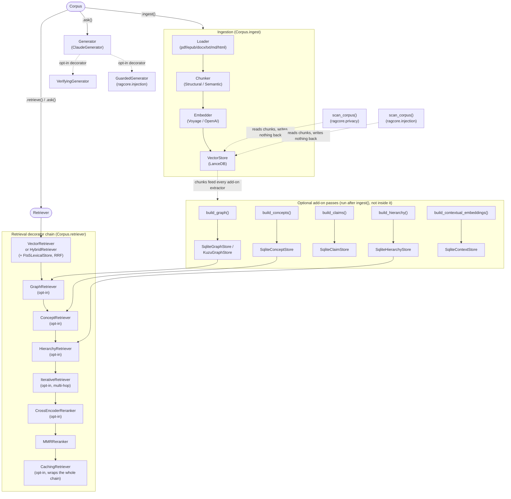
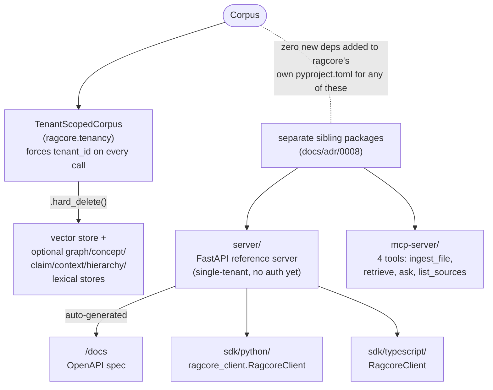

# System diagram

Phase 9 deliverable. Renders natively on GitHub; paste into
[mermaid.live](https://mermaid.live) for a standalone view. Reflects
the codebase as of commit `e8e8909` — update this alongside
`docs/ARCHITECTURE.md` when the shape of a pipeline changes, not just
when a module is added.

## Core pipeline + add-on layers

A consuming project builds exactly one `Corpus` and drives everything
through it. The five add-on layers (graph, concepts, claims, hierarchy,
contextual) are separate, optional `build_*()` passes that run *after*
`ingest()`, never inside it — see `CLAUDE.md`'s "Concept layer" section
for why. `Corpus.retriever` is a swappable attribute: any subset of the
decorator chain on the right can be wired on top of a plain
`VectorRetriever`/`HybridRetriever`, in the order
`ragcore.retrieval.stack.default_stack()` documents.

## Multi-tenancy + the sibling packages (Phase 7/8)

`ragcore/` itself never grows a server, a CLI, or global state
(`docs/adr/0009-library-not-application.md`). Everything below the
dashed line is a *separate* package that depends on `ragcore`, not code
inside it.

## What's deliberately not shown

- The exact id-generation formulas for `chunk_id`/`source_id`/
  `entity_id`/`concept_id`/`claim_id` — see
  `docs/adr/0010-content-addressed-identity.md`.
- Checkpoint/resume plumbing for every `build_*()` pass — each one's
  own module docstring covers its exact fingerprint scheme.
- The full eval harness (`ragcore.eval`) and versioning/snapshot
  orchestration (`ragcore.versioning`) — see `docs/RUNBOOK.md` for the
  latter.
